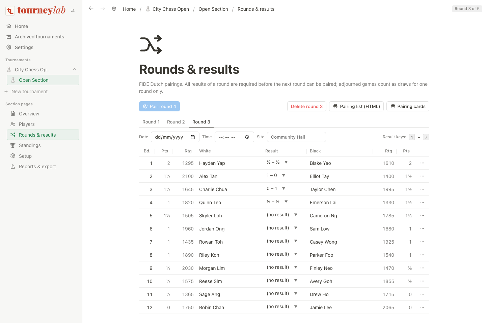
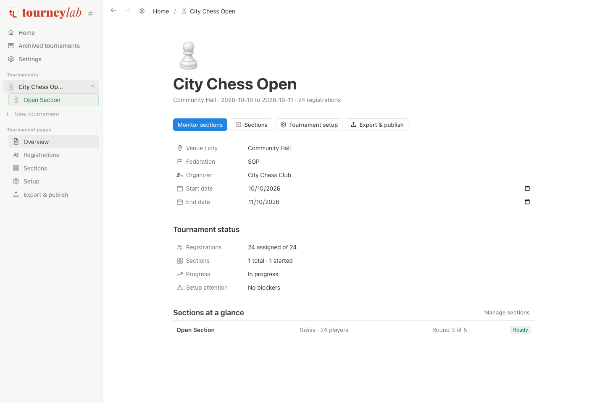
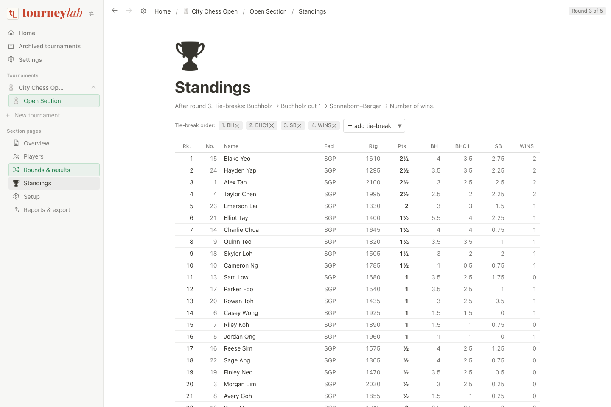
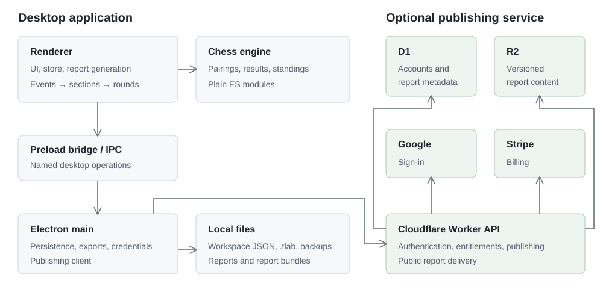

# TourneyLab

A desktop app for running chess tournaments. Manage registrations, create sections, pair rounds, enter results, and export standings from one workspace.

Built with **Electron, JavaScript, and a custom chess pairing engine**. An optional **TypeScript / Cloudflare Workers** service handles hosted results, accounts, and billing.



## What it does

- **Tournament management:** multiple events and sections, shared registrations, section assignments, schedules, and setup defaults.
- **Pairing and results:** individual and team Swiss, round robin, double round robin, knockout, and other formats. Includes manual pairing, byes, withdrawals, colour swaps, and keyboard result entry.
- **Standings:** configurable tie-breaks, including Buchholz and Sonneborn–Berger, with selectable rule versions for unplayed rounds.
- **Import and export:** CSV, HTML reports, PGN, TRF, XML, and supported Swiss-Manager `.TUNx` files.
- **Local storage:** workspace autosave, `.tlab` tournament files, and rotating tournament backups.
- **Optional publishing:** export reports locally or publish through a separate service with Google sign-in and Stripe billing.

## Screenshots

Captured from the application renderer in Chrome Beta using fictional players and a sample tournament. The desktop app uses the same interface; native window controls and file dialogs are not shown.

### Tournament overview

Track registrations, sections, and round progress.



### Standings

Review scores and tie-break values after recorded results.



## Architecture



| Layer | Responsibility |
| --- | --- |
| Renderer | Plain JavaScript UI, navigation, tournament state, and report generation. |
| Chess engine | Pairings, result state, standings, tie-breaks, and format adapters. Runs as ES modules without Electron. |
| Preload bridge | Exposes specific desktop operations through `window.tl` and Electron IPC. |
| Electron main process | File dialogs, workspace persistence, backups, report bundles, and publishing credentials. |
| Optional publishing service | Cloudflare Worker API, D1 metadata, R2 report storage, Google authentication, and Stripe billing. |

Tournament operations run locally. The renderer calculates pairings and standings; the main process handles filesystem access. The publishing service is separate and is not required to run an event or export reports.

See [Architecture](docs/architecture.md) for the data flow and design decisions.

## Run locally

Use Node.js 22 and npm. Run these commands from the project folder:

```bash
npm ci
npm start
```

This launches the Electron desktop app. No cloud account is required for local tournament management.

## Checks

```bash
# Desktop, engine, persistence, and export tests
npm run test:desktop

# Install the optional publishing service dependencies
npm --prefix publisher ci

# Run both test suites and the publisher type check
npm test
npm run typecheck:publisher
```

The desktop suite uses Node's test runner. The publishing suite uses Vitest with Cloudflare's Workers runtime and local D1/R2 bindings. Tests cover pairing constraints, tournament workflows, file compatibility, reports, authentication, and publishing.

The public repository excludes private tournament files and two integration suites that depend on real tournament fixtures. The included tests run without those files. Screenshots use fictional data; service configuration contains placeholders only.

See the [publishing service setup](publisher/README.md) for local service configuration and deployment requirements.

## Current scope

This is a development project, not a certified tournament pairing product. Automated tests do not establish FIDE certification or complete compatibility with other tournament software.

- The Dutch engine uses a bounded search and fallback handling for difficult score groups. Full earlier-bracket backtracking remains a limitation.
- Native `.TUNx` export uses an imported source file. Creating new native `.TUNx` files and supporting `.TURx`, `.TUTx`, and `.TUMx` remain out of scope.
- Managed publishing requires external Cloudflare, Google, and Stripe configuration. The service code is included; a live service is not required for this project preview.

## License

[MIT](LICENSE).
